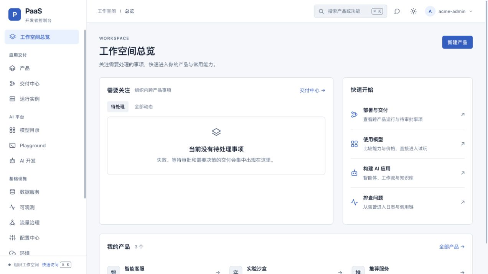
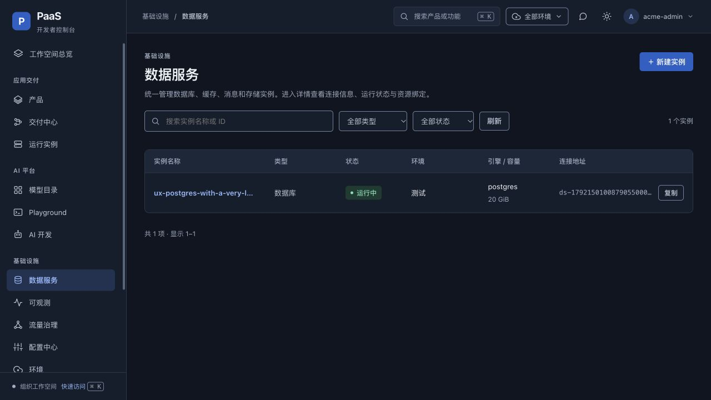
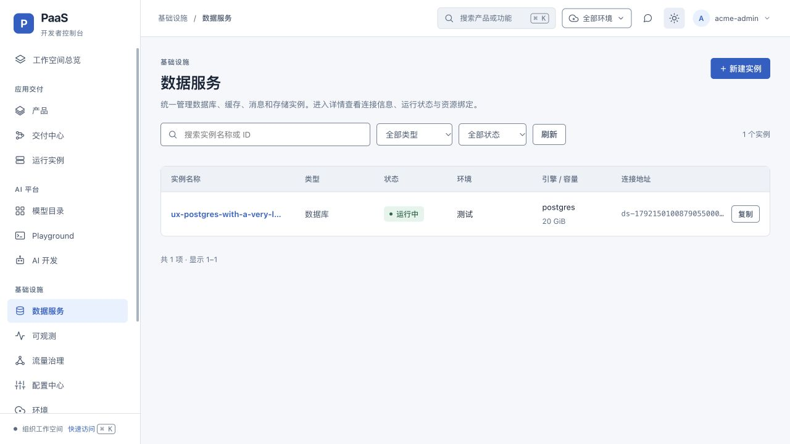

# 新版控制台重构验收记录

日期：2026-10-16。对应 [设计与两版取舍](../../superpowers/specs/2026-10-16-console-next-ux-refactor.md)。

## 本次结果

新版 `/next/` 已完成本地代码重构。结合经典版的能力完整性，重新组织全局导航、产品工作区和交付子导航；恢复成熟的 AI 开发、Playground、环境、配置及安全相关视图。经典版 `/console/` 未修改。

## 自动检查

在 `frontend/` 目录运行，最终版本全部通过：

```bash
pnpm --filter @paas/console-user-v2 build
pnpm --filter @paas/console-user-v2 lint
pnpm --filter @paas/console-user-v2 test:ux
```

- `vue-tsc --noEmit` 与 Vite 生产构建通过。
- ESLint 通过。
- 6 项有行为意义的回归用例通过：列表 null 解包、准确的失败记录深链、全环境基线选择、能力导航可达性、深浅主题关键 token 对比度、命令搜索匹配优先级。
- `git diff --check` 通过。

对比度测试只覆盖定义的关键 token，不等于完整 WCAG 合规认证。

## 浏览器交互验证

预览地址：`http://127.0.0.1:5176/next/`。前端对接本机 8080 的纯内存后端；该后端使用仓库已有的 `bin/core`，不是本次重新编译的后端，因此这些结果不能替代当前后端版本的集成验收。

| 场景 | 已观察结果 |
|---|---|
| 登录后总览 | 产品、任务空态与四条快速入口正常显示；通知 `data:null` 不再使页面报错 |
| 数据服务长名称、长地址 | 长文本省略；完整值可查看；复制按钮保持一行；环境显示名称 |
| 组合筛选 | 搜索和类型同时保留在 URL；清除筛选后恢复完整列表 |
| 模型试玩 | 点击第二个模型的试玩入口，Playground 正确预选该模型；价格 0 正常显示 |
| 命令搜索 | 搜索“知识库”，精确目标排第一；Enter 正确打开知识库 |
| 小屏与宽表 | 在 320、768、1024、1440px 宽度观察，页面未被宽表撑开；宽表在容器内滚动 |
| 小屏导航 | 默认收起；可展开；Escape 关闭并恢复触发按钮焦点 |
| 产品工作区 | 服务运行、交付、共享资源、配置、成员职责分离；可进入准确实例 |
| 部署入口 | 明确展示“运行部署流水线”；无 CD 时禁止运行并引导配置；未发起部署 |
| 深浅主题 | 两种主题的实际页面均检查过 |

长地址、两个模型和未部署服务为本地内存测试数据，不是集群或供应商运行证据。没有发送真实推理请求。

## 截图







## 尚需目标环境验收

本次没有提交 Git、push 或部署 `paas.k8s.dd`，没有修改持久化数据库、执行真实流水线、生产审批或支付。

上线前应使用目标版本后端，对不同角色、真实产品与环境、流水线阶段目标、生产确认、失败构建日志及真实模型通道进行集成回归。本次也没有将经典版所有高级页面宣称为全量对等迁移。
