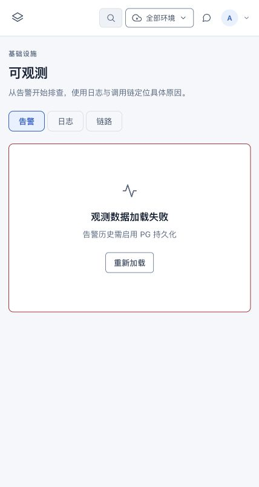

# 新版控制台补全后复评

最新全模块检查与六项专项设计请从 [全模块检查](./all-modules-audit.md) 和 [专项总设计](../../superpowers/specs/2026-10-17-console-module-improvements-design.md) 进入；本文件下文保留早先补齐前的检查快照，不能作为最新缺项清单。

日期：2026-10-17。代码基线：分支 `console-v2`，HEAD `97790a1`。本次只评估并记录，没有修改业务源码、发起部署或提交 Git。

后续用户授权“补齐”后，修复与重新设计见 [实现与验证记录](./implementation.md)。下文保留为修改前的复评快照。

## 判断

当前新版的任务分组、产品内职责划分和公共视觉系统可以继续保留；但不能认定已完成经典版功能对等迁移。部分模块完成了路由和列表，管理动作、上下文传递和排障闭环仍缺失。上一轮对“恢复成熟能力”的描述不能扩展为全量功能对等。

指标页确实漏迁，并非藏在更深入口：新版 Observability 只声明 alerts/logs/traces，未消费仍然存在的 listMetrics。注释把告警、日志、链路称为“三支柱”，也掩盖了 Metrics 缺席这一事实。

## 优先问题

### P1：数据服务写操作可能把失败显示为成功

- `frontend/console-user-v2/src/views/DataServiceDetail.vue:85-135`：启停、重启、伸缩、删除调用 fetchAuth 后未检查 Response.ok，直接提示成功；fetchAuth 按契约返回原始 Response，不对 HTTP 错误抛异常。
- 伸缩额外存在确定的接口不匹配：前端 `submitScale` 使用 POST，当前后端 `internal/dataservice/handler.go:472` 只接受 PUT，返回 405 后前端仍会提示“伸缩指令已下发”。
- 应统一检查写操作 HTTP 结果；失败保留上下文和错误提示，成功后再刷新。该问题由当前前后端源码直接确认，本次没有执行真实写操作来复现。

### P1：指标与告警管理没有完成迁移

- 新版 `Observability.vue:17,162` 只有告警/日志/链路，无指标卡、趋势、实体健康矩阵；`api/observability.ts:38` 的 listMetrics 无页面消费者。
- 经典版 `Observability.vue` 已有 CPU、内存、RPS、P95 延迟、错误率，以及应用/环境/数据服务维度下钻。
- 新版规则只有启停，缺新建、阈值编辑、删除；对应 API 仍存在。
- 数据服务详情也缺经典版已有的监控、实体告警配置；文件头“在 /observability 维度过滤”的说明与实际实现不符。

### P1：交付管理被缩减为展示，无法独立完成配置与恢复

| 能力 | 经典版 | 新版当前状态 |
|---|---|---|
| 仓库 | 创建内置仓库、绑定外部仓库、克隆、浏览、PR 评审、解绑 | DeliveryRepos 只有列表 |
| 流水线 | 查看并编辑阶段、参数、删除、触发 | DeliveryPipelines 主要只有列表与触发；弹窗说明目标来自配置，却没有配置编辑入口 |
| 发布 | 创建、详情、历史、回滚 | DeliveryReleases 只有列表；文案“可回滚”没有对应操作 |
| PR | 列表、diff、评审、合并 | 新版路由未承接 Pulls/PullDetail |

这会让“新产品 → 接仓库 → 配流水线 → 运行 → 失败恢复”的流程在新版中断。证据：两版 `AppRepositories.vue / DeliveryRepos.vue`、`AppPipelines.vue / DeliveryPipelines.vue`、`AppReleases.vue / DeliveryReleases.vue` 及各自 router.ts。

### P2：可观测上下文与交叉定位中断

- 新版 Observability 不读取 route.query，不监听环境 store；顶栏虽显示环境选择器，查询仍只有 appId/range 等局部状态。
- `LaneDetail.vue:96` 传入 `?app=&lane=...`，接收页却忽略 lane，不能保证看到该泳道的链路。
- 从日志只能复制 traceId，不能直接定位链路；缺旧版按 ID 查询 trace 和 trace 关联日志的闭环。
- 共享的产品/时间变量切换后，另一个已加载 tab 不会重新查询（loadedTabs 永久跳过），可能显示旧上下文的数据。
- 应让 URL 成为上下文真源，区分环境、产品、服务/数据服务、泳道、时间窗；不支持的维度明确提示，不能显示一个实际未生效的筛选器。

### P2：告警历史不可用会挡住整个告警页

- `Observability.vue:29-36` 把实时告警、规则、历史放在一个 Promise.all 中；任意一个失败都进入整页错误。
- 本地纯内存后端实测显示“告警历史需启用 PG 持久化”，实时告警与规则也被挡住。这是本地环境的复现，不代表线上 PostgreSQL 环境也触发了同一错误。
- 页面从历史 ev 映射实时状态，而非独立渲染实时 al；历史限取 30 条，也不能保证完整包含所有当前告警。应分开数据源与失败边界。

### P2：数据服务详情的运维能力继续缺项

- 经典版已有 Pod 诊断、镜像升级、CPU/内存/存储规格调整、监控与备份记录；新版当前仅连接信息、生命周期、副本伸缩、绑定应用。
- 备份在经典版也是“记录型 CRUD”，不是可证明已完成的真实快照。若补回，必须保留该边界；新版创建表单的“自动拉起与备份”不应作为真实备份能力承诺。

### P2：补齐页面仍有失败态与文案不一致

- Secrets 新增两表分页有效减小渲染量，但 loadSecrets/loadAudits 在 HTTP 非成功时没有错误态，可能显示空数据或旧数据。
- Secrets 创建成功文案称“值掩码存储，展示与传输均不可见明文”，与代码的明文请求提交、后端掩码响应语义不符；应改成“保存成功，后续页面仅展示掩码”。
- 数据服务“绑定应用”仍引导去“设置 → 绑定资源”，新版实际名称已变为“共享资源”。这种遗留用语会继续造成找路成本。

## 对补全效果的评价

- **信息架构**：按任务域分组比两版原先的资源堆叠更合理，独立总览与产品入口值得保留。
- **视觉与列表**：统一标题、状态、表格溢出、筛选、公共分页有实际价值；密钥和审计分页是合理补充，但仅减少 DOM 数量，尚未解决后端全量加载。
- **完成度**：AI、环境、配置等已有可用入口，但不能用“页面已挂路由”替代操作与验收对等；此次抽查已确认多处功能缩减。
- **可靠性**：写失败提示成功、环境上下文不生效，比缺少样式细节更应优先修。

建议保留现有骨架，先修写操作结果，再补指标与实体下钻，再恢复交付配置/PR/回滚。无需再次推翻全局布局。

可观测建议一级内导航为 **总览 / 指标 / 日志 / 链路 / 告警**；规则管理放告警内。共用上下文，按需加载，独立展示错误，不把所有内容同时堆回首页。

## 验证边界

- 已重新运行新版 build（含 vue-tsc）、ESLint、6 项 test:ux，全部通过。
- 浏览器实查本地 `/next/observability` 的告警、日志；代码对照经典版可观测、数据服务、仓库、流水线、发布与路由。
- 当前本地后端是上一轮启动的内存实例；没有将本地失败直接推断为线上失败。
- 本次是重点模块复评，未覆盖每个 AI 工具、每种角色、所有状态及线上完整 E2E；不能给出有证据支撑的全平台完成百分比。

