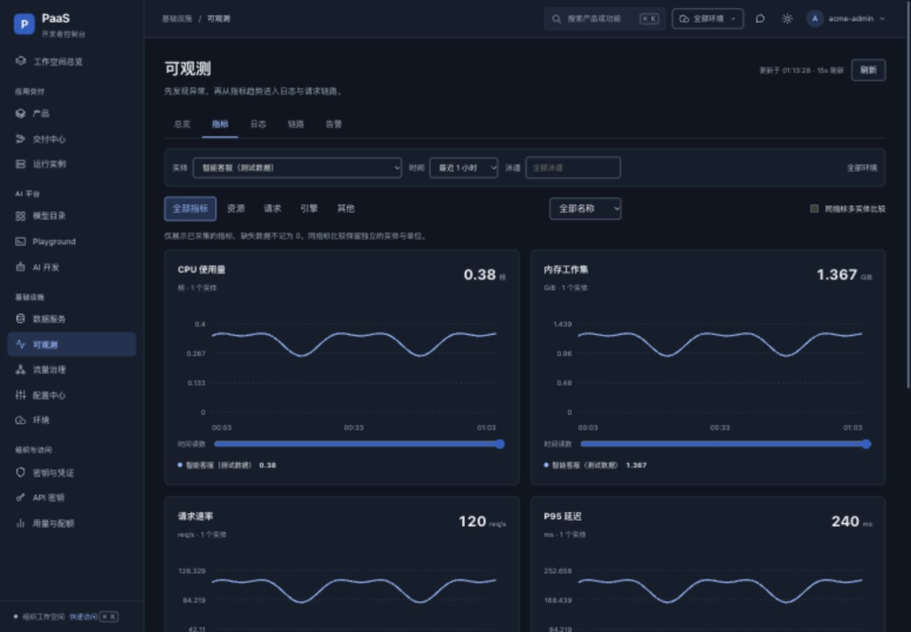

# 缺项补齐、指标重设计与 TraceID 验证

日期：2026-10-17。承接本目录 README 的复评问题；未提交 Git、push 或部署集群。

## 已实现

| 复评项 | 本次实现 |
|---|---|
| 写失败报成功 | fetchCommand + requireOK 显式拒绝非成功 HTTP；数据服务启停、重启、规格、升级、删除使用检查后的结果。scale/upgrade 使用 PUT |
| 指标缺失且旧版设计不佳 | 新建 MetricChart，与旧小柱图无关；总览实体表 + 资源/请求/引擎/其他分类 + 时间轴趋势 + 当前值 + 悬停/键盘读数 + 同指标多实体比较 |
| 指标范围与单位 | 展示实际返回的全部指标名；不同单位不合并。CPU、内存、延迟按同一图表比例统一换算；有效 0 保留，缺失与无效样本不伪装为 0 |
| 环境/泳道不生效 | 环境与泳道先经租户工作负载清单解析为精确实体；没有匹配实体不退回全租户查询。上下文保留在 URL，切换时重新加载，旧响应不可覆盖新范围 |
| 告警管理 | 新建、编辑、阈值、目标实体选择、启停、删除、Webhook；实时告警、规则、历史独立加载与报错，不依赖最近历史推导实时告警 |
| TraceID 排障 | 精确查询入口、日志一键跳链路、完整已返回 span 瀑布、父子缩进、服务/对端、错误摘要、span 详情与全部属性、关联日志、TraceID 复制 |
| 仓库/PR | 恢复内置仓库创建、外部绑定、克隆、浏览、解绑、PR 列表、diff、评审、合并确认；适配新版路由 |
| 流水线 | 从平台模板添加绑定、编辑触发与阶段参数、目标服务选择、删除、运行；修复空构建参数行无法保留的问题 |
| 发布 | 创建时选择明确服务、环境、泳道与镜像；保留生产确认；恢复回滚和独立详情，按发布记录的 workloadId 查询实际实例，避免任取一个基线 |
| 关联详情 | 补变更与批次详情路由，修复 DevOps 链接真源与镜像/仓库定位 |
| 数据服务运维 | 增加指标、实例告警入口、Pod 诊断、CPU/内存/存储与副本调整、镜像升级、备份记录；消息服务补主题与消费组管理。外部实例不展示托管运维操作 |
| 密钥/审计 | 保留原分页，补独立读取失败态，纠正“掩码存储/传输不可见明文”的错误成功文案 |

## TraceID 实现判断

后端已有 `GET /api/observability/traces/{traceID}`，直接查询 Jaeger 的单 trace 接口，解析整个返回记录的 spans，而非在当前列表中搜索。TraceID 校验与租户归属校验保留。

检查时发现 Jaeger `process.tags` 中的 OTel resource 属性被转换过程丢弃。已合并 process 与 span 属性，后者同名覆盖前者，并新增测试验证 Pod/环境属性与请求级泳道覆盖。否则前端基于这些属性的定位会丢失上下文。

前端使用所有返回 span 构建树、保留孤儿根节点，以 trace 的时间范围绘制偏移与耗时。错误 span 可查看原因、对端、ID、属性，并查询关联日志。精确查询不受当前列表的产品/时间/泳道筛选隐藏，页面明确说明这一点。

“整条链路”指采集系统已经收到的该 TraceID 的全部 span。未采样、未透传 trace context、未导出或已过保留期的调用无法由前端恢复。后端耗时目前是整数 ms，亚毫秒细节不在本轮改动范围。

## 自动验证

在 `frontend/`：

```bash
pnpm --filter @paas/console-user-v2 build
pnpm --filter @paas/console-user-v2 lint
pnpm --filter @paas/console-user-v2 test:ux
```

全部通过。12 项前端回归覆盖列表解包、目标选择、失败深链、导航、对比度、命令匹配、HTTP 写入失败、数据服务 method 契约、环境/泳道范围、指标有效点/统一单位、交付链接、完整 span 树与对端/错误展示。

在仓库根目录：

```bash
go test ./internal/observability/... -count=1
```

整个可观测模块通过，包括 Jaeger 转换、TraceID/租户校验和本次资源属性回归。`git diff --check` 通过。

## 浏览器验证

正常预览继续使用 `http://127.0.0.1:5176/next/`，对接已有纯内存后端。该后端未接 Prometheus/Loki/Jaeger，返回空指标是正常的未接入状态；页面不会添加演示数据。

为了验证有数据时的图表与排障流程，额外启动了 **5177 → 9082 的隔离测试代理**。该代理只给观测接口提供明确标注的测试数据，其余读取转发到本机内存后端，业务写操作统一拒绝。本次没有用测试数据冒充线上采集，也没有发起真实部署。

已观察到：

- 指标分类、正确的 CPU/内存单位、有效 0、两实体同指标比较正常渲染。
- 320 / 768 / 1024 / 1440px 下，文档宽度均不超过视口；SVG 使用 ResizeObserver 适配，刻度保持 11px，不因固定 viewBox 在手机上缩成不可读文字。
- 日志“查看链路”通过 TraceID 打开单条记录，3 个 span、3 个服务、1 个错误 span 全部可见；点击错误 span 显示父 ID、偏移、耗时和原因，关联日志正常加载。
- 历史接口 501 时，实时告警与规则仍正常显示；历史区域单独提示不可用。
- 数据服务规格提交在隔离代理返回 403 后，显示拒绝原因，保留表单，没有出现成功提示；实例未修改。
- 流水线“添加”表单可读取后端提供的 CI/CD 模板；仓库、PR、发布管理操作的真实外部服务写入未执行。

## 目标环境限制

- 本轮只读请求 `paas.k8s.dd` 的链路列表在 15 秒后超时，未拿到线上 TraceID，不能判断线上端到端采集健康。
- 新增后端资源属性合并尚未部署；本机已有 core 二进制也未替换。Go 测试证明源码转换契约，浏览器测试证明前端交互，二者不是目标环境上线证明。
- 链路环境/泳道筛选使用上报属性对最近 100 条候选过滤，无相应标签的记录不会混入。查更早记录应使用 TraceID；这不是服务器端无限历史检索。
- 备份仍是记录管理，不是真实快照执行。不同角色和真实供应商、仓库、部署、回滚链路仍需目标环境验收。

## 指标新设计截图

下图为隔离测试数据，产品名称已标注“测试数据”，用于验证布局与趋势交互。


