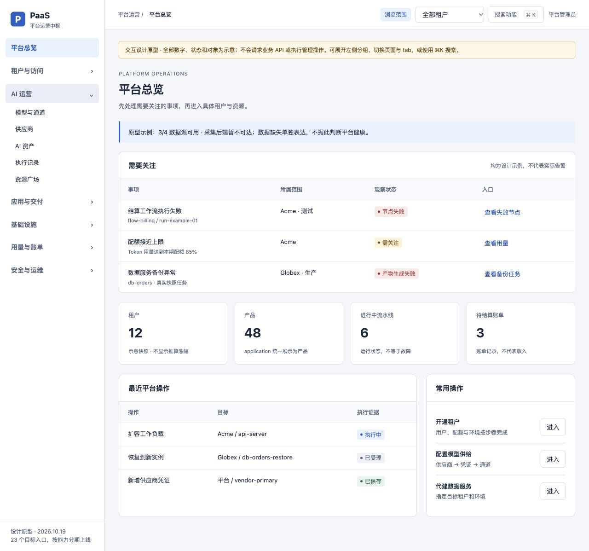
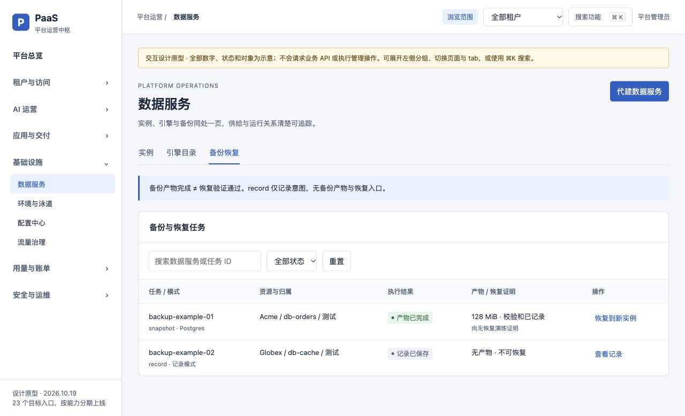

# 管理后台设计交付与检查记录

日期：2026-10-19。范围：仅设计与原型；没有实施业务代码或执行管理写操作。

- [完整设计与28项能力矩阵](../../superpowers/specs/2026-10-19-admin-ia-and-management-design.md)
- [其他 agent 的分批实施清单](../../superpowers/plans/2026-10-19-admin-optimization-handoff.md)
- [离线交互原型](prototype.html)

原型可直接用浏览器打开 HTML；也可在本目录运行 `python3 -m http.server 4186 --bind 127.0.0.1` 后访问 `http://127.0.0.1:4186/prototype.html`。临时预览服务不是部署。

## 已检查

| 项目 | 结果与边界 |
|---|---|
| 当前源码菜单 | 8个可见顶级、26个可见叶子、29个页面路由（含3个隐藏页面），迁移表全部覆盖 |
| 能力矩阵 | M01—M28连续，区分既有能力、部分基础与新管理契约，并列P0/P1/P2 |
| 文档链接 | 设计与计划互相引用及原型路径存在 |
| 原型脚本 | 提取内联JS后 `node --check` 通过；无业务网络请求和真实写操作 |
| 浏览核验 | 本地新版用户端 `/next/` 导航与首页；本地嵌入后台 `/admin/` 首页；两者与当前工作树源码结合判断 |
| 制品差异 | 嵌入后台首页仍是旧词条；当前源码已更名。未把运行制品当当前源码，也未部署新制品 |
| 原型交互 | 首屏目视检查；搜索“备份”直达数据服务·备份恢复；选Acme后移除Globex示例记录；record模式无恢复；恢复说明明确新实例、租户/环境/配额与非覆盖语义 |
| 代码改动范围 | 只新增本组设计文档、原型与截图；未修改业务源码，未切分支、提交或部署 |

## 尚未验证

原型是浅色桌面交互草图，其他页面为结构示意；不代表完整后台实现、真实授权、后端过滤、深链接、响应式、暗色与可访问性验收完成。未运行业务测试、CI、供应商调用、K8s运维或恢复演练；这些在实施清单中分别安排。

当前后台源码 Vite 预览曾因沙箱禁止绑定端口而未启动，没有因此修改现有服务。原型在独立本机临时端口预览成功；无需依赖业务接口。

## 总览设计

## 备份恢复设计

