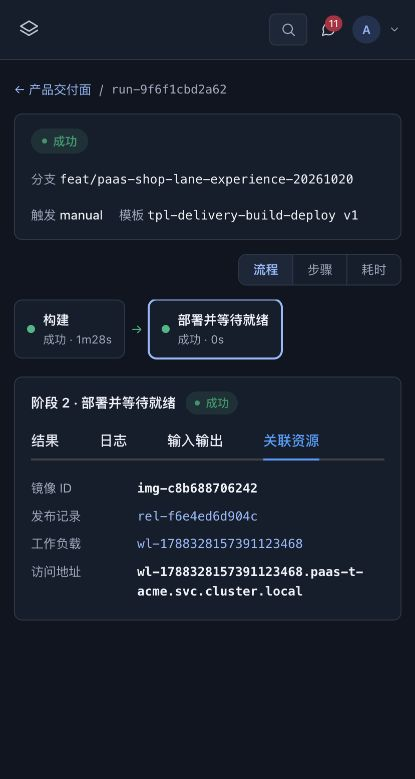

# 新版交付流程 P0 测试集群发布

日期：2026-10-20（北京时间）。授权范围：现有测试环境。

## 平台 Core 升级

- Helm release：`paas`；namespace：`paas`；revision **379**，状态 `deployed`；更新时间 17:05:43。
- 本次实际使用命令行 `helm upgrade`，**没有执行 `scripts/deploy-k8s.sh`，没有通过 PaaS 流水线发布 Core**。平台升级记录位于 `helm history paas -n paas`，不能把它描述成平台内流水线记录。
- 读过仓库脚本；脚本除构建/push/Helm 外，还应用知识库资源、CRD 和本地 values。本次为排除工作区其他改动，从 `c395e2eb00d8f997ada55994e0c459f07eea5e9c` 加本次 31 文件/局部修改生成隔离制品，复用 revision 378 的线上 chart 和 values，只替换 Core 镜像。
- 镜像：`192.168.41.122:30050/paas/paas-core:delivery-p0-20261020-6095de2f`。
- digest：`sha256:7ca5872361d9b0b2c952d532a67cc7124f85c4522a954a8d0d1d474d44f3d8fe`，已核对实际 Core Pod imageID。
- 源码清单 SHA256：`6095de2f4cb34348c74bfc9055630d6133ab55700676dab5f100bfcb26620064`。未在根仓提交或 push。
- Helm 使用 `--reuse-values --atomic --wait --timeout 5m`；渲染清单对比只有 Core 容器 image 变化。旧 revision 378 和旧镜像保留。
- `/livez` 正常，三标准模板存在，`/next/` index 与隔离构建产物逐字节一致；工作负载详情可返回实际 1/1 Ready。

## 通过新版页面运行真实 PaasShop 流水线

17:19:58 在 `/next/` 产品交付页选择“构建并部署”，预览后确认：

| 项目 | 实际值 |
|---|---|
| 产品 / 服务 | paas-shop / bff |
| 目标 | `env-acme-test` / `default` |
| 仓库 | 集群内 Gitea `paas-bot/paas-shop`，`repo-5efbd2b0facd` |
| 分支 | `feat/paas-shop-lane-experience-20261020` |
| 锁定提交 | `a3f80e632c03d0e74570063fd4ac67699e723076` |
| Dockerfile / context | `paas-shop/Dockerfile.backend` / `.` |
| buildArgs | `{"SERVICE":"bff"}` |
| 标准模板 | `tpl-delivery-build-deploy` v1 |
| PipelineRun | `run-9f6f1cbd2a62`，succeeded |
| BuildRun / K8s Job | `build-f97a25eeed90` / `paas-t-acme/paas-build-build-f97a25eeed90`，success / succeeded=1 |
| 镜像 | `img-c8b688706242` |
| Release | `rel-f6e4ed6d904c`，sourceRunId=`run-9f6f1cbd2a62` |
| 工作负载 | `wl-1788328157391123468`，1/1 Ready |

17:21:26 流水线完成，构建耗时约 88 秒。构建日志实际 checkout `a3f80e6`；push、镜像记录、Release、运行 Pod 的 digest 均为：

`sha256:df2412bbb8574844ade6e9439fd6d48554797c5f2e3ba936890951679a707f27`

这是相同提交重构建，产物 tag/digest 与原 BFF 一致，因此 Deployment 无新的 Pod 滚动替换；本次证明真实构建、发布记录关联和当前产物就绪，不证明不同镜像的滚动切换。

只读检查 `/healthz`、`/api/platform/lanes`、`/api/products` 均返回 200。9 个非测试环境工作负载的 image/imageRef 与发布前一致。未执行订单、支付等业务写入。

## 查看记录与证据

- [新版控制台](http://paas.k8s.dd/next/) → 产品 → paas-shop → 交付。
- [本次流水线](http://paas.k8s.dd/next/runs/run-9f6f1cbd2a62) → 构建/部署阶段 → 日志、输入输出、关联资源。
- [发布记录](http://paas.k8s.dd/next/releases/rel-f6e4ed6d904c)。历史独立发布仍显示“独立部署 · 未关联流水线”，没有补造来源。
- [脱敏结构化证据](deployment-evidence.json)。不包含 Helm values、Secret manifest 或工作负载环境变量。
- [线上截图](pipeline-live.jpg)。

## 验收边界与后续

- 未执行不同 digest 的滚动切换、完整业务写入、生产发布或全量 PG 回归。
- 运行详情返回的 `workloadDomain` 未验证 DNS 可达性；此次健康检查经真实 BFF Deployment 临时端口转发完成，不能把展示地址当成访问验收。
- 平台自身升级目前仍是 Helm 操作；建议后续为部署脚本补充“发布已构建镜像、复用线上配置、产物与操作者记录”模式，并接入平台升级记录。此建议尚未实现，本次没有为补记录重复升级。
- 上一轮浏览器读取曾因自动审批额度不足未执行；用户继续后审批恢复，页面真实验收已完成。
