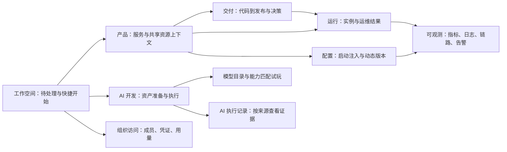

# 新版控制台专项完善总设计

日期：2026-10-17。状态：设计交接，尚未实施或环境验收。

依据：[全模块检查与源码证据](../../reviews/2026-10-17-console-next/all-modules-audit.md)。范围为 `/next/` 用户控制台；不重建管理员控制台，不把治理、DevOps 等插件逻辑塞入 Platform Core。

## 1. 优先完善什么

保留当前任务域与主要路由。现在的主要短板是：资产能创建但依赖未确认；操作能提交但实际结果难判断；多个执行系统共享名称但记录不互通。这三个问题优先于继续增加卡片和大屏。

| 专项 | 目标 | 优先级与依赖 | 详细设计 |
|---|---|---|---|
| 01 工作流与执行 | 可正确编排、验证与重现；执行来源清楚 | P1 插入/删除与快照；P2 图形/聚合 | [01](2026-10-17-console-ai-workflow-design.md) |
| 02 AI 资产就绪 | 智能体、KB、工具、Prompt、Skill、广场形成准备→试用闭环 | P1 主列表/依赖/激活；P2 版本与安装向导 | [02](2026-10-17-console-ai-assets-design.md) |
| 03 模型试用与诊断 | 能力匹配、消息正确、计量可信 | P1 错误消息与字符计数；扩玩法先核 API 能力 | [03](2026-10-17-console-model-experience-design.md) |
| 04 变更与观测反馈 | 配置、流量、环境与观测清楚表达“提交到生效”的证据 | P1 配置批量结果与观测部分失败；P2 采用确认 | [04](2026-10-17-console-change-feedback-design.md) |
| 05 数据服务运维 | 按引擎/接入模式操作；备份结果有可恢复证据 | P1 真实边界；P2 真实执行及恢复演练 | [05](2026-10-17-console-dataservice-operations-design.md) |
| 06 访问与用量 | 权限/凭证作用域可理解；用量、估算和结算口径准确 | P1 失败态/账单语义；P2 最小权限和轮换 | [06](2026-10-17-console-access-usage-design.md) |

运行、研发交付和泳道继续使用已有专项；只对本轮新增缺口做增量，不另起平行框架：

- [服务运行设计](2026-10-17-service-runtime-operations-design.md)
- [研发交付设计](2026-10-17-development-delivery-design.md)
- [泳道与访问设计](2026-10-17-lane-access-experience-design.md)

## 2. 信息架构与职责

“AI 工作流”“CI/CD 流水线”“智能研发 AgentRun”保留三个领域；它们可共享时间线、日志和证据组件，但不得统一成一套执行状态机或假装具有相同审批/重试语义。

产品内保留服务运行/交付/共享资源/配置/成员权限。配置内显式区分“启动配置（重建后注入）”“动态配置（发布快照，客户端采用）”。组织级资产写操作不借顶栏环境隐式定目标。

AI 的八个 URL 保留，导航视觉分三组：构建（智能体、工作流）、资产（知识库、工具、提示词、技能）、使用与追踪（广场、执行记录）。仍是一层子导航，分组不新增页面层级。窄屏可横向滚动，不能把后半能力藏在不可见区域。

## 3. 共用页面与视觉规则

**主角是当前任务和结果证据。**列表提供选择和比较，详情提供判断与下一步，复杂编辑进入独立工作区；不让大型表单、运行历史和输出挤在一个抽屉。

| 区域 | 设计约束 |
|---|---|
| 页头 | 面包屑、对象名、作用域、一个主要动作；AI 子页面不重复“AI 开发”大标题 |
| 作用域条 | 显示组织/产品/真实资源环境/泳道；“继承默认配置”与“环境基线”用不同名称；写操作确认复述实际目标 |
| 列表 | 筛选、数量、分页、刷新时刻；名称与状态优先，ID 次要可复制；首项导航动作最多 2 个，其余进入更多菜单 |
| 详情 | 先摘要、阻塞原因/下一步，再证据；不把几十项字段平铺成同权重描述列表 |
| 状态 | 文案＋图标＋颜色；准备未完成、运行中、等待决策、失败、数据未知互不替代 |
| 操作 | 请求中禁重复提交；异步受理显示操作记录链接，完成以执行证据为准；失败保留用户输入 |
| 弹层 | 只承载短任务；宽度 min(设计宽度, 视口减 32px)，底部动作可见；离开复杂编辑提示未保存 |
| 密度 | 主内容 14px、辅助信息 12–13px，沿用 theme.css token；间距以 8/16/24px 为主；ID/日志等宽，避免整表等宽 |
| 图表 | 单位、时间范围、时区、数据源、采样间隔明确；无数据不画零线，部分结果带说明；趋势图可切可访问的数据表 |

1440px/1280px 常用桌面首先保证主任务；1024px 收起侧栏/属性面板；768px 以下纵向排列任务区，表格局部横滚，不要求复杂 DAG 在手机可完整拖拽编辑，但应能查看与审批。亮暗主题、200% 缩放、长名称/中文/大输出均列为验证条件。

图/列表/耗时不是装饰性三个按钮：只有支持不同任务时提供多视图。工作流用拓扑图解释分支、执行列表解释实际路径；CI/CD 沿用现有运行多视图；资产列表默认表格，广场保留卡片。

## 4. 跨模块读取、权限和动作约定

每块数据至少区分 loading、empty、ready、error；轮询区额外区分 stale/partial/unavailable。初次读取失败不显示“暂无”；后台刷新失败保留旧数据并显示读取时间。主对象与引用统计分别取数，辅助接口失败不能让已有资产消失。

统一动作解释：**目标 → 改什么 → 影响对象 → 是否需要后续执行 → 结果证据**。危险操作沿用现有确认，不增加每次浏览都确认的弹窗。前端禁用理由改善可理解性，后端授权/租户隔离/环境检查始终负责最终裁决；不在前端推断额外权限。

建议逐领域返回 capabilities：supported、allowed、reason、必要条件。数据源新鲜度可采用 source/observedAt/coverage 语义，但不是所有业务共用一份巨大状态接口。缺契约时显示“状态未知/未提供证据”，不生成虚拟健康值。

所有新契约均是**设计提案**，需进入已有 Go route registry、OpenAPI 与生成类型；兼容现有 `{data:T}` 包装及旧 URL。前端预览所选目标与后端执行目标一致；使用资源版本/计划 hash 的领域自行完成并发保护。

## 5. 可访问性与标准依据

采用 WCAG 2.2 AA 相关交互要求作为设计与测试目标，不宣称当前已符合全部标准。非内联操作优先保持 ≥32px 点击高度，并检查至少 24×24 CSS px 或满足规范的间距/例外条件；Tab 可达、焦点可见、弹层关闭回到触发点、异步结果可被辅助技术感知，错误不只依赖 toast。[W3C 点击目标说明](https://www.w3.org/WAI/WCAG22/Understanding/target-size-minimum.html)、[状态消息说明](https://www.w3.org/WAI/WCAG22/Understanding/status-messages.html)。

期望与观测结果分开，依据 Kubernetes 对 spec/status 的区分；这是本项目对运维反馈的设计应用，不意味着 Kubernetes 会提供配置消费者确认或财务证据。[Kubernetes 对象模型](https://kubernetes.io/docs/concepts/overview/working-with-objects/)。

## 6. 交付方式与成功条件

先修正确性与误导状态，再补任务闭环，最后收敛视觉。当前不预估人天；契约和运行环境准备情况决定工作量。具体包、依赖与验收见 [实施交接清单](../plans/2026-10-17-console-module-improvements-implementation.md)。

每个专项交付包含：真实/模拟/未接入边界、角色和环境矩阵、失败案例、深链返回、源代码与运行版本对应关系。没有真实环境证据时应写“源码/本地验证完成，环境验收待完成”，不得据此宣称全部模块完善。
