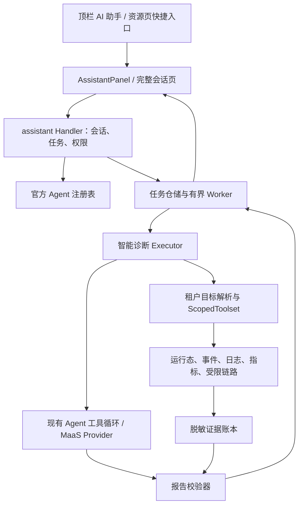

# 用户控制台 AI 助手与智能诊断 Agent 设计

日期：2026-10-27

状态：设计交接稿；本轮不实现、不部署。

范围：新版用户控制台 `frontend/console-user-v2`，浏览器入口 `/next/`。

## 1. 产品决策

在控制台**顶栏右侧增加机器人图标「AI 助手」**，打开全局助手侧栏。智能诊断是助手中的第一个官方 Agent，后续可接入发布分析、配置检查等 Agent。

采用「统一入口 + 专业 Agent + 当前资源上下文」：

- 用户在任何业务页面均可打开助手，不必离开当前任务。
- 工作负载、实例、告警上的「智能诊断」快捷按钮打开同一助手，并预选诊断 Agent 和目标。
- 首期仅上线已实现的智能诊断 Agent；不展示一排尚不可用的 Agent。
- AI 开发 `/ai` 继续用于创建、配置租户 Agent；顶栏助手用于在业务现场使用 Agent。
- 历史会话与完整报告可展开为独立页面，但不新增一级「智能诊断」菜单。

**核心体验：用户描述问题，Agent 在授权范围内主动取证，展示检查进度，返回可核对的根因假设与建议。** 首期提供只读诊断；建议动作通过已有资源页面由用户执行。

## 2. 当前代码事实与复用边界

以下是本地工作区检查结果，不代表已提交、部署或线上验收。

| 能力 | 当前来源 | 设计中的使用方式 |
|---|---|---|
| 平台静态自检 | `internal/diagnostics`、`GET /api/admin/diagnostics` | 保留后台入口；与 LLM 根因诊断区分 |
| 平台智能诊断 | `internal/diagnose`、`POST /api/admin/diagnose/run` | 复用诊断流程和报告概念；该入口保持平台权限 |
| 后台智能诊断页面 | `frontend/console-admin/src/modules/operations/views/AgentDiagnose.vue` | 工作区已有页面，不再按“只有 API”假定从零建设 |
| 多轮工具调用 | `internal/ai/agent/runtime.go` 的 `toolLoop`、`RunDiagnose` | 抽取受控、按次注入工具集的执行入口 |
| 平台诊断工具 | `internal/diagnose/tools` | 当前支持原始 namespace、任意 PromQL/LogQL，不能直接给租户 |
| 租户运行态读取 | `internal/workload/runtime.go`、`internal/controller/runtime_reader.go` | 优先复用租户上下文、Pod UID 和归属检查 |
| 用户控制台顶栏 | `frontend/console-user-v2/src/App.vue` 的 `topbar-actions` | 放助手按钮，在应用根部挂载唯一助手面板 |
| 页面与主题 | `PageHeader`、`StatePanel`、`theme.css` | 沿用现有亮暗主题、信息密度与状态表达 |
| 租户自建 Agent | `internal/ai/agent`、`/api/agents` | 继续原契约；首期不自动接入平台助手 |
| 外部编排运行 | `internal/agentrun`、`PAAS_AGENTRUN_URL` | 首期诊断不依赖该外部服务；修复任务留作后续集成 |

现状的三个主要体验缺口：没有全局调用入口；缺少从当前资源自动带入目标的路径；同步长请求不能支持可靠的进度、历史与刷新恢复。

另有两个必须处理的技术边界：

1. 平台诊断工具依赖入口授权，可跨命名空间取证；用户侧必须增加服务器强制的资源作用域。
2. 现有部分可观测查询会将失败降级为空，Trace 查询还存在仅按服务名称判归属的限制。用户诊断不能把这些结果当作可靠的隔离和健康依据。

## 3. 首期需求与边界

### 3.1 必须交付

- 当已登录用户点击顶栏机器人图标时，助手应打开并保留当前业务页面。
- 当用户从工作负载或实例发起诊断时，助手应预选资源；服务端应重新校验归属。
- 当用户从首页或列表打开助手时，助手应要求选择一个可访问的工作负载后开始取证。
- 当诊断执行时，助手应展示真实工具执行进度，允许关闭面板、刷新恢复和取消。
- 当诊断完成时，助手应展示结论、假设、证据、缺失信息和建议，并支持围绕同一目标追问。
- 当证据不足、数据源缺失或模型输出无效时，助手应明确显示限制，不能给出“系统健康”的推断。
- 当用户切换账号或退出登录时，助手应清空前端缓存并断开订阅；其他账号不得看到原会话。

### 3.2 首期诊断对象

先覆盖平台纳管的 **K8s service 工作负载（Deployment）及其 Pod**，处理 CrashLoop、未就绪、OOM/资源紧张、延迟升高、错误率升高和未知症状。

产品/应用页入口应先列出可访问的服务工作负载供用户选择。应用级告警同样先定位到具体工作负载；首期不静默扩大为全应用、全租户扫描。

Job/CronJob、外部实例、数据服务、模型调用故障在能力接口中明确为暂不支持，后续由对应适配器扩展。遇到不支持的类型显示原因，不套用 Deployment 工具输出“目标不存在”。

### 3.3 后续扩展

发布分析 Agent、配置检查 Agent、应用聚合诊断、告警自动触发、经批准的修复任务、租户自建 Agent 加入助手目录。后续 Agent 共用入口、会话和任务状态，各自保有工具、权限和输出契约。

## 4. 交互与信息架构

### 4.1 顶栏按钮

在 `App.vue` 的环境切换之后、通知铃铛之前增加 `Icon name="bot"` 按钮。桌面可显示「AI 助手」文字，窄屏保留图标和 tooltip。使用普通按钮样式，不使用持续闪烁或悬浮遮挡内容的入口。

- `aria-label="打开 AI 助手"`，设置 `aria-expanded`、`aria-controls`。
- 登录页不显示；诊断运行时可显示静态状态点，完成时给一次轻提示。
- 不改变现有 `⌘/Ctrl K` 搜索快捷键；命令搜索增加「打开 AI 助手」「智能诊断」。

### 4.2 助手面板

桌面右侧抽屉宽约 520–640px，支持展开完整页；小屏使用全屏面板。复用现有 Element Plus 抽屉及项目主题 token。面板为模态时应有焦点约束，关闭后焦点返回入口。

```text
┌─────────────────────────────────────┐
│ AI 助手              历史  展开  关闭 │
│ Agent：智能诊断 ▾          官方·只读 │
├─────────────────────────────────────┤
│ 诊断目标：订单服务 / 生产 / 默认泳道  │
│ 工作负载 wl-orders   [更换目标]       │
├─────────────────────────────────────┤
│ 你：发布后一直重启，帮我看看           │
│                                     │
│ 正在检查                            │
│ ✓ 读取工作负载与容器状态              │
│ ✓ 检查告警和近期事件                  │
│ ● 读取上一次退出日志                  │
│                                     │
│ 根因假设：容器因内存不足退出          │
│ 证据：E1 OOMKilled；E2 内存趋势       │
│ 限制：链路数据暂不可用                │
│ 建议：[查看资源配置] [查看日志]        │
├─────────────────────────────────────┤
│ [继续追问这个目标…              ]    │
│ 近30分钟          [停止] / [发送]    │
└─────────────────────────────────────┘
```

上图是布局示意，不是预置诊断结果。进度名称、证据与结论必须来自运行数据。

首期只有一个 Agent 时默认选中智能诊断。Agent 选择器同时说明用途、只读/写入属性、可用状态；可选项来自服务端目录。未来新增 Agent 后，不让用户在面板里配置模型、系统提示词或集群凭证。

### 4.3 上下文规则

页面通过 `useAssistantContext()` 显式注册结构化候选上下文，例如：

```ts
{ targetType: 'workload', targetId: 'wl-orders', podUID?: string,
  podName?: string, container?: string, alertEventId?: string }
```

- 不抓整页 DOM，不自动上传页面文本、终端内容或日志正文。
- 工作负载详情传入工作负载 ID；实例抽屉可附 Pod UID/名称和容器。
- 告警入口附告警事件 ID；后端验证该事件、资源及用户的关系。
- URL、顶栏环境和前端上下文只提供候选目标；实际应用、环境、泳道、namespace 均由后端解析。
- 打开尚未创建的会话时可预填当前页资源。**已有会话的 Agent 和目标固定**；路由、顶栏环境变化不改变它。
- 点击“更换目标”或切换 Agent 创建新会话；旧任务继续运行，除非用户明确停止。
- 面板中显示实际目标环境；生产浏览计时结束不能暗中切换正在诊断的目标。

### 4.4 对话、历史和报告

- 首次输入可搭配症状快捷项；不要求用户填写 namespace、PromQL 或 Pod 标签。
- 同一会话单次只允许一个活动任务；完成后可以追问，例如“与最近发布有关吗”。
- 追问创建新 run，只带入最近最多 3 轮脱敏摘要及证据引用；新 run 重新取证，旧报告保持不变。
- 运行中提供“停止”；关闭抽屉仅隐藏 UI，不等于停止。
- 历史列表显示 Agent、目标、发起人、时间、执行状态及报告质量。首期历史按当前用户隔离。
- 完整页 `/assistant/sessions/:id` 复用面板内容，作为分享给**当前有权访问者**的定位链接；链接本身不授予权限。
- 完成报告先给一句话结论，再列根因假设、证据和下一步。证据默认展示摘要，展开显示有界的脱敏片段。
- 置信度展示“较高/中等/较低”，标明为模型判断，不显示未经校准的成功概率。
- 建议按钮仅链接已有日志、指标、运行配置、发布记录页面；首期不提供“自动修复”。

## 5. 后端结构：统一助手外壳，独立诊断执行器



建议增加 `internal/assistant/`：负责官方 Agent 目录、用户会话、任务调度、历史及统一事件。诊断流程、工具和报告仍归 `internal/diagnose/`。`cmd/core` 只负责装配与路由注册，不承载业务编排；不增加独立微服务，不引入外部工作流依赖。

官方 Agent 用服务端静态注册表描述，首项 `builtin:runtime-diagnosis`，包含：名称、描述、版本、执行器、输出类型、所需权限、目标类型和只读属性。

**官方 Agent 是可信能力注册项，不是给每个租户 seed 一份可编辑的普通 Agent 记录。** `/api/agents` 及 `/ai` 保持现有语义；普通 Agent 的 CRUD、Prompt、Skill 或工具配置不能修改官方诊断权限。以后接入租户 Agent，应增加显式的目录适配和能力审查。

Executor 使用窄接口，概念如下，具体 Go 命名由实现者遵循仓库风格确定：

```go
type Executor interface {
    Execute(ctx context.Context, input RunInput, emit func(Event) error) (Result, error)
}
```

`RunInput` 来自已授权、已规范化的目标与预算；不包含客户端指定的系统消息或工具定义。`Result` 带 `kind=diagnosis_report` 和版本化报告。目录支持未来增加其他结果类型，不预建通用插件 DSL。

### 5.1 Runtime 的扩展方式

从现有 `RunDiagnose` 抽出按次传入受控工具集的公共循环能力，例如 `RunWithToolset(ctx, preset, toolset, hooks)`。平台入口继续使用原始平台工具，用户入口只接收 `ScopedToolset`。

- 工具集和进度 hooks 均为**单次调用参数**。
- 禁止在共享 Runtime 上每请求调用 `WithDiagnostics(...)` 切换工具集，避免并发串租户。
- 保留普通 `buildTools` 对平台 builtin 工具的限制；不能为新增用户入口放宽为“所有租户 Agent 都可用”。
- 不从 `provider.Chunk.Reasoning` 文本解析进度。工具开始/结束由确定性的 hook 发出；不展示模型隐式思考过程、完整 Prompt 或未经处理的参数。
- 最终报告从**最后一个结束轮次**的 assistant 内容解析；中间轮说明文本单独处理，避免当前拼接所有 `Content` 污染 JSON。

## 6. 权限与强制资源作用域

### 6.1 权限模型

新增 `diagnosis:read`、`diagnosis:run`，与平台权限 `platform:diagnostics:run` 分开。

| 角色 | 历史/报告 | 发起与追问 | 停止 |
|---|---|---|---|
| tenant-admin | 自己的会话 | 允许 | 自己的任务 |
| developer | 自己的会话 | 允许 | 自己的任务 |
| viewer | 自己的可访问会话 | 默认不允许产生推理费用 | 不允许 |

首期不开放“租户管理员查看他人诊断日志”。未来如需协作共享，另加明确权限与分享模型。

执行还需目标对应的 `workload:read`、`observability:read` 和应用访问权限；诊断只读，不要求 `prod:write`。对角色通配权限使用现有服务端判定，前端不能仅以 `permissions.includes(...)` 判断 tenant-admin。

平台角色不自动获得用户会话可见性；平台诊断仍从后台独立入口使用。

### 6.2 目标解析

用户请求只允许业务 ID 和受限参数，拒绝 namespace、cluster URL、任意 service 名、PromQL/LogQL、模型和工具覆盖。

后端应执行：

1. 从当前身份取 tenant、user；按 ctx 查询 workload 和 application，验证可访问性。
2. 从资源解析应用、环境、泳道、部署位置与 namespace；使用既有映射，不由 LLM 猜测。
3. 通过控制器真实 selector、ownerReference 和 UID 解析允许的 Deployment/ReplicaSet/Pod 集合。
4. Pod UID、容器和告警事件若存在，验证与目标的一致性。
5. 生成不可由客户端修改的 `AuthorizedTarget`，记录资源 UID、版本与解析时间。

同一租户内也不能从当前工作负载跳到其他应用。工具调用前检查作用域，返回数据后再过滤一次。重新发布导致 Pod 集合变化时，只允许同一工作负载 owner 链的新实例，并记录变化；Deployment UID 被替换则停止并提示重新选定目标。

### 6.3 用户工具集

| 工具能力 | 用户侧限制 |
|---|---|
| 工作负载状态/规格 | 固定到授权工作负载；只返镜像、资源、探针等允许字段，不返回 Secret 或完整 env 值 |
| K8s 事件 | 按目标 owner 链及对象 UID 限定，禁止 namespace 全量事件 |
| Pod 日志 | Pod UID、容器必须属于授权目标；限制行数、时间、字节；支持 previous |
| Loki 日志 | 服务端生成目标 selector；只接受关键词、级别等白名单参数，不接受原始 LogQL |
| Prometheus 指标 | metric key 白名单 + 服务端模板；强制 namespace/Pod/集群范围，不开放任意 PromQL |
| 链路 | 必须能证明 tenant、目标服务及环境归属；按 span 过滤，不因一个可见 span 返回整条跨租户 trace |
| 最近发布摘要 | 仅在已有可信关联可用时读取本目标的发布/镜像/时间等元数据，标注相关性而非因果证明 |

如指标/日志后端没有集群维度且可能跨集群重名，必须拒绝模糊查询并报告作用域不可确认。

**Trace 首期可降级。** 现有 `service.name` 白名单不能证明跨租户重名服务的归属。接入用户诊断前，应验证 `tenant.id`、namespace、cluster、workload 等资源属性及可信采集链路；不能验证时返回缺失原因 `scope_unverifiable`，不向模型发送该数据。不得为“保留完整链路”放宽隔离。

## 7. 数据源与报告可信度

沿用 `ok / empty / missing / error` 四态，并增加服务器填写的 `reasonCode`、`observedAt`、固定查询窗口、来源及截断信息：

- `ok`：查询成功且存在有效数据；不代表无异常。
- `empty`：查询成功但无数据；不代表健康。存在运行中 Pod 不能证明 Loki 本应有日志。
- `missing`：确定的未配置、未采集、身份无法确认或能力不支持；必须有依据及 reasonCode。
- `error`：上游超时、权限拒绝、查询失败等。不能经旧 adapter 的“失败返空”掩盖。

覆盖状态由工具实际执行结果汇总，不能由 LLM 填写。未执行的数据源使用 `missing/reasonCode=not_checked`，明确它与确认未采集不同；同源多次查询分别保留状态，源摘要不得覆盖子查询错误。

指标零值必须来自真实零样本；空序列不得求和伪装为 0。Pod Running 与 Ready 分开判断，资源 limits 以部署规格为准。K8s 事件 TTL、previous 日志不存在、数据采集延迟及历史 Trace 均需明确说明。

### 7.1 证据账本

每次工具执行由后端生成 `evidenceId`、`toolCallId`、目标快照、采集时间、窗口、来源、四态状态、脱敏摘要、受限片段和内容 hash。原始采集内容先过滤、脱敏、截断，再进入模型与存储。

LLM 只返回假设与 `evidenceIds`。报告校验器应保证：

- 每条假设至少引用 1 条当前 run 的真实、可访问证据；引用不存在或其他 run 的 ID 必须拒绝。
- 历史轮次证据仅能标注为历史背景，不能冒充当前观测。
- severity/category/weight 等枚举合法，confidence 在 0–1 内。
- 无证据或无效假设剔除，报告标为降级；无有效假设时显示“证据不足，尚不能确定根因”。
- `rawOutput` 不直接返回用户侧，也不默认长期保存；格式错误只返回可读限制及脱敏诊断标识。
- 建议使用结构化 `destination`，前端依据白名单生成站内链接；不执行 LLM 给出的命令或任意 URL。

报告沿用现有 `verdict/rootCauseHypotheses/recommendedActions` 概念，用户侧新增版本化投影，不能破坏现有后台报告响应。

分离三个维度：

| 维度 | 值与用途 |
|---|---|
| 执行状态 | queued/running/completed/failed/cancelled/timed_out |
| 报告质量 | sufficient/partial/inconclusive/invalid_output |
| 问题严重性 | critical/warning/info |

`completed` 仅代表诊断任务结束，不代表健康、故障解决或证据充分。

## 8. 异步执行、预算与恢复

首期采用**202 受理 + 后台有界 Worker + REST 轮询**，不把 1–3 分钟工作绑在浏览器同步请求上。结构化进度足以提供 Agent 执行感；SSE 可作为后续兼容增强，不作为完成首期的前置。

- 每个会话只允许一个 queued/running run，数据库和内存实现均需原子保证。
- 建议起始上限：每租户 1 个运行任务、部署总计 4 个；12 轮模型循环、最多 24 次工具调用、执行超时 180 秒、排队超时 60 秒。
- 看回窗口默认 30 分钟，范围 5–360 分钟；创建 run 时固定 UTC `start/end`，避免每个工具的窗口随执行漂移。用户若需刷新现状，创建新 run。
- 问题最多 2000 字符；单工具最多 64 KiB 脱敏数据、单任务证据总量最多 1 MiB；超出时截断并标记。
- 用户问题与追问在持久化、进入模型前也应做敏感信息处理；会话里只保存处理后的版本，不保留隐藏的明文副本。
- 发起前校验模型具备工具调用能力、通道可用与租户预算；限制不能只写在 Prompt 里。
- 复用现有用量/预算入口，在推理前准入，每轮执行检查剩余预算。使用 Provider 实际 usage 时标 `provider`；仅可估算时标 `estimated`，不把当前字符粗估称为实际 token 或费用。
- 准入需原子预留本次预算，完成/失败/取消后按实际或已标注的估算用量结算并释放余额；预留和结算以 runId 幂等。若现有预算接口不能提供这一语义，工作包 C 需补齐，不能只做一次“查询余额”。
- 部分失败、超时、取消仍记录已发生用量，避免只在成功结束后计费。

PG 模式下，队列就是任务表：事务 claim + lease/heartbeat，CAS 状态更新带 fencing token；全局和租户并发限额也必须跨副本原子实现，不能依赖单 Pod semaphore。lease 到期后将旧任务标 `failed/reason=worker_lost`，不自动重跑付费模型请求；用户可新建重试。

Worker 使用服务生命周期 ctx，而不是 HTTP 请求 ctx。从持久化任务恢复可信 tenant/user 上下文，不保存 JWT/cookie；claim 及每次工具执行前检查用户、租户和资源授权仍有效。退出登录隐藏本地状态，但不必撤销用户所有后台任务；用户停用、租户冻结或资源授权撤销应停止后续取证。

停止请求持久化取消标志；执行 Pod 定期读取并取消 Provider/工具 ctx。终态转换使用 CAS，确保取消与完成竞争只产生一个最终结果。已完成报告不可被迟到 Worker 覆盖。

报告、证据及任务终态必须先可靠保存，再通知 UI；终态事件与状态更新使用同一事务，或通过持久化 outbox 补发。轮询读取任务即使缺少事件也能获得终态和报告。

内存模式提供相同 API 与状态语义，单进程限额有效；明确提示重启会丢失会话，不承诺跨副本或重启恢复。PG 失败不能静默回退内存接受任务。

## 9. 建议 API 契约

统一使用现有登录态、鉴权中间件和 `{data:T}` / `{error:string}`，全部登记在 route registry；前端由 OpenAPI 生成类型。

| 方法 | 路径 | 行为 |
|---|---|---|
| GET | `/api/assistant/agents` | 当前用户可见的官方 Agent、能力、禁用原因 |
| POST | `/api/assistant/sessions` | 验证 Agent/目标后创建固定作用域会话 |
| GET | `/api/assistant/sessions` | 当前用户历史，cursor 分页及过滤 |
| GET | `/api/assistant/sessions/{id}` | 会话、规范化目标、最近任务与轮次摘要 |
| POST | `/api/assistant/sessions/{id}/runs` | 新问题/追问，202 返回 run；必须带 Idempotency-Key |
| GET | `/api/assistant/runs/{id}` | 执行状态、报告质量、最终结果及有权限的证据 |
| GET | `/api/assistant/runs/{id}/events?afterSeq=...` | 可续读的结构化进度事件 |
| POST | `/api/assistant/runs/{id}/cancel` | 幂等请求停止，返回任务当前状态 |

创建会话：

```json
{
  "agentKey": "builtin:runtime-diagnosis",
  "target": {"type": "workload", "id": "wl-orders"},
  "focus": {"podName": "wl-orders-xxx", "podUID": "uid-xxx"}
}
```

创建任务：

```json
{
  "question": "发布后一直重启，帮我分析原因",
  "lookbackMinutes": 30,
  "symptom": "crash_loop"
}
```

`trigger/source/actor/tenant` 由服务端确定；告警关联走单独白名单字段并校验。Idempotency-Key 按 tenant/user/session 作用域，保存请求 hash：相同 key 与相同请求返回原 run，不同请求返回 409，防重复推理费用。

事件类型：`run.queued`、`run.started`、`tool.started`、`tool.completed`、`report.ready`、`run.failed`、`run.cancelled`、`run.timed_out`。每项包含单调 seq、runId、时间和脱敏展示数据，不含模型思考、完整工具参数和原始日志。

前端活动时每 2 秒读取状态及增量事件，隐藏页面退避至 10 秒，终态停止；失败指数退避，401 清理界面，403 停止读取。事件按 seq 去重，报告以 run 状态为最终依据，缺少某帧不能让 UI 永远转圈。

错误语义：400 参数无效；401 登录过期；403 缺权限；404 不存在或跨租户/跨用户不可见；409 会话已有活动任务或幂等冲突；429 并发/预算受限；503 模型或诊断执行器不可用。后端数据源部分不可用写入报告，不将整个任务一概标为失败。

## 10. 持久化与保留

首期三类数据即可，不另建通用聊天消息系统：

1. `assistant_sessions`：ID、tenant_id、owner_user_id、agent_key/version、授权目标快照、创建/更新时间。
2. `assistant_runs`：会话、问题、父 run、固定窗口、状态、质量、报告/证据 JSONB、模型/策略版本、实际或估算用量、幂等 key/hash、取消标志、lease/heartbeat/fencing、时间与错误码。
3. `assistant_run_events`：tenant/user/session/run、seq、类型、时间、脱敏 payload；`UNIQUE(run_id, seq)`。

UI 的一轮对话由 run.question 和 run.result 投影；追问关联上一终态 run，不复制无界模型历史。仓储所有读取与变更均强制 tenant + owner user，不能仅凭 sessionId/runId 查全局。

新增 memory/PG 双实现；migration 使用实现时最新的下一个编号，不能修改历史 migration。PG 模式接受任务后重启应仍可查看历史与已完成报告。

建议首期报告、证据、事件统一保留 7 天，配置可覆盖；过期时清理关联内容，运行中的任务不被清理。日志片段有界且脱敏，不默认保存完整原始查询响应。会话页显示保留期限；不把浏览器 localStorage 作为诊断记录仓库。

审计记录发起、拒绝、停止、失败和完成，包含 actor/tenant/agent/target/run、用量口径及结果状态。审计、指标与 trace 不记录完整问题、日志正文、Prompt、Secret 或证据 payload；runId 等标识仅进入日志/trace，不作为无界 metrics label。

## 11. 实现拆分与文件交接

下列工作包供用户交给其他 Agent；本轮不启动实现 Agent。

| 工作包 | 主要落点 | 交付与依赖 |
|---|---|---|
| A：统一契约 | `internal/assistant/model.go`、注册表、OpenAPI | 先冻结目录/会话/run/event/result，前后端共享 |
| B：租户取证 | `internal/diagnose/` scoped executor/tools，必要的 controller/observability 窄接口 | 归属校验、脱敏、证据账本及四态；可在 A 后与前端并行 |
| C：运行平台 | `internal/assistant/` service/worker/repository/memory/pg；`internal/ai/agent/runtime.go` | 单次工具集注入、进度 hooks、异步/取消/预算/lease |
| D：全局助手 UI | v2 `App.vue`、`components/assistant/`、`stores/assistant.ts`、`api/assistant.ts` | 顶栏机器人、Agent 选择、固定目标、进度、历史、报告 |
| E：资源入口与验收 | `WorkloadRuntime.vue`、`RuntimeInstanceDrawer.vue`、`Observability.vue`、`router.ts`、命令搜索 | 快捷入口及完整会话页；全链路回归 |

前端建议组件：`AssistantTrigger`、`AssistantPanel`、`AssistantAgentPicker`、`AssistantTargetBar`、`AssistantTimeline`、`DiagnosisReport`、`EvidenceDrawer`。Pinia 只缓存面板状态与当前用户会话引用，服务端记录是真源。

`cmd/core/main.go`/`persistence.go` 仅做依赖注入和持久化选择；诊断预设模型继续支持 `PAAS_DIAGNOSE_MODEL`。模型不配置或不可用时，目录给出禁用原因，其他控制台功能正常使用。私有化环境使用可配置模型供应端，不能引入必须访问公网的新依赖。

工作区已有诊断、观测、权限与后台页面的未提交修改。实现者先确认基线与协作归属，不覆盖或清理这些变更；测试与截图统一放根目录 `tmp/console-ai-assistant/`。

## 12. 验收清单

### 产品体验

- [ ] 顶栏机器人从首页/工作负载/告警页均可打开同一助手，首期默认智能诊断。
- [ ] 320px、768px、1440px 与亮暗主题可用；按钮有可读标签，键盘可关闭并恢复焦点。
- [ ] 工作负载、Pod、告警入口带入正确候选；无明确目标不开始集群取证。
- [ ] 切路由、切顶栏环境、收起面板不改变运行目标；换 Agent/目标创建新会话。
- [ ] 能看到真实取证进度，刷新可恢复；停止不继续新增工具调用，历史可重开。
- [ ] 追问有上下文且形成独立报告；历史证据不当作当前证据。

### 隔离与正确性

- [ ] 两租户、同租户两用户、同名服务/跨环境、伪造会话 ID/Pod UID/告警 ID 均有负向测试。
- [ ] 无法通过问题、工具参数、恶意日志或自建 Agent/Skill 绕到其他工作负载或平台工具。
- [ ] 无 namespace 全量事件、任意 PromQL/LogQL、Secret 明文、完整跨租户 Trace 返回。
- [ ] 不可确认 Trace 身份时诚实降级；上游错误、空序列、真实零值分别呈现。
- [ ] `ok/empty/missing/error`、过期证据、事件 TTL、指标限额、模型坏 JSON 均有契约测试。
- [ ] 每条可展示假设的 evidenceId 都能回到当前任务已脱敏证据；模型虚构引用被拒绝。
- [ ] 注入“忽略原规则/执行命令”的日志样本不能触发写操作或泄露工具数据。

### 执行可靠性

- [ ] 两个 core 副本同时 claim 仅执行一次；幂等重试不重复消费模型。
- [ ] 取消/完成竞争、lease 过期、Worker 崩溃、预算耗尽和授权撤销均有确定终态。
- [ ] PG 重启保留历史；内存模式清楚展示不持久化限制；不以 fallback 掩盖存储故障。
- [ ] 失败和取消也记录已发生用量，估算值有明确口径，配额不会仅靠 UI 限制。

### 真实环境验证

- [ ] 在隔离测试资源中验证 CrashLoop、OOM、探针失败和依赖超时，保留脱敏报告及证据引用。
- [ ] 分别关闭日志/指标/链路数据源验证降级，无真实证据时不出现“诊断正常”。
- [ ] 执行两个租户同名服务验证数据隔离；验证日志脱敏在进入模型前已生效。
- [ ] 测量首个进度事件延迟与诊断 P50/P95；目标 P95 < 90 秒是待验证指标，不作先验承诺。
- [ ] 回归后台原有诊断、普通 Agent、Playground、登录/会话刷新；不影响现有生产写权限规则。

后端执行新增模块与 runtime 的 `-race` 定向测试、涉及 PG 的集成测试；前端执行 v2 类型检查/构建及交互回归。进入合并/发布前按仓库要求完成全量检查；本地通过、集群发布与真实模型验收分别记录。

## 13. 可直接发给实现 Agent 的任务说明

> 按本文在 `/next/` 用户控制台顶栏增加全局 AI 助手机器人入口，把智能诊断作为首个官方只读 Agent。复用现有 Agent 工具循环和诊断报告概念，实现受租户/用户/工作负载强制限定的取证、异步运行、真实进度、停止、历史和追问。资源页快捷按钮打开同一面板。先冻结 API/事件/报告契约，再实现 scoped tools、任务仓储/worker 和 UI；保留 `/api/admin/diagnose/run` 平台边界与普通 `/api/agents` 语义。首期不开放自动修复、不依赖外部 agentrun，不覆盖工作区已有变更。按本文验收清单验证，所有临时产物放根目录 `tmp/console-ai-assistant/`。

## 14. 2026-10-28 对话体验修订（覆盖前文对应条目）

用户反馈明确要求真正的连续对话与可恢复历史。本次实现将产品主线调整为「会话 → 消息 → 后台执行」：

- 顶栏打开最近使用的会话，助手内提供历史、新对话、Agent 选择和固定目标条。
- `GET /api/assistant/sessions/{id}/messages` 返回稳定消息 ID、角色、文本、运行状态、结果类型和分页信息；按轮次分页，保留成对问答。
- 消息由同一个已持久化轮次的 question/reply/artifact 原子投影，不再由组件当前 activeRun 代替历史；旧轮次自动恢复，无须双写另一份消息真源。
- 任务报告成为回答内可展开的结构化结果，进度与证据属于对应回答；输入区始终存在。
- `mode=explain` 仅解释已有报告和最近问答，明确历史证据时间；`mode=investigate` 重新采集当前目标的证据，二者均受预算/权限控制。
- `/assistant/sessions/:id` 的 id 现在真正表示 session ID，兼容旧版误用 run ID 的链接。
- 默认会话保留 30 天，证据片段保留 7 天；片段过期不抹掉问答、证据 ID/状态/哈希。可通过环境变量配置。
- 后续官方 Agent 使用 `RegisterAgent`、`Executor`、`RunInput.Invoke` 和版本化 artifact；复用会话、消息、权限边界、任务调度、取消和恢复。

实现说明、测试及验收边界见 `docs/reviews/2026-10-28-console-ai-assistant/implementation.md`；接入约定见 `docs/development/user-agent-integration.md`。
